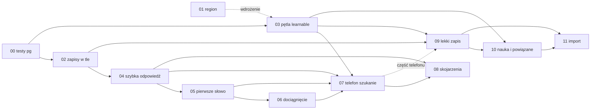

# Taski przyspieszenia szukania i zapisu słów

Instrukcje implementacji do `docs/optymalizacja-requestow.md` i `docs/wzbogacanie-karty-schemat.md` po weryfikacji z 8 listopada 2026. Odbiorcą jest model AI, który wykonuje jeden task w jednej sesji. Decyzje i pomiary są w dokumentach źródłowych. Tu jest kolejność, zakres każdego kroku, warunek startu i sposób sprawdzenia.

Każdy task ma te same części: zakres, zależności, warunek startu, pliki, zachowanie, kroki, sprawdzenie i ryzyka.

## Jak wykonać task

### Przed pierwszą zmianą

1. Przeczytaj ten plik w całości, potem cały plik taska, potem rozdział dokumentu źródłowego wskazany na górze taska.
2. Przeczytaj w całości każdy plik z sekcji „Pliki” i testy, które ich dotyczą (`rg -l "<nazwa funkcji>" backend/tests android/app/src/test`).
3. Wykonaj „Warunek startu”. Gdy któraś komenda nie daje wyniku, poprzedni task nie jest zrobiony: przerwij i napisz to użytkownikowi. Nie implementuj brakującego taska po drodze.
4. Zapisz stan wyjściowy testów:
   - backend: `cd backend; .venv\Scripts\python.exe -m pytest -q` (8 listopada: 475 zielonych, 2 pominięte),
   - Android, gdy task go dotyczy: `cd android; .\gradlew.bat testDebugUnitTest`,
   - całość jak w CI: `python scripts/ci_check.py`.
   Test czerwony przed zmianą zapisz w raporcie i nie naprawiaj go, chyba że task tego wymaga.

### W trakcie

- Nazwy funkcji, pól i numery linii w taskach pochodzą z commitu `33a3b6d`. Gdy linia się przesunęła, szukaj po nazwie. Gdy funkcja nie istnieje albo działa inaczej, niż task zakłada (inne argumenty, inne miejsce zapisu, inny warunek), przerwij i opisz różnicę. Nie zgaduj intencji.
- Zmieniaj tylko pliki z sekcji „Pliki”, ich testy i pliki napisów. Bez refaktoryzacji poza zakresem, bez zmiany formatowania niezmienianych fragmentów.
- Tekst promptu przepisuj dosłownie z taska albo z dokumentu źródłowego. Nie poprawiaj go.
- Serwer ma zostać zgodny wstecz: stary telefon nie wysyła nowych pól i dostaje dzisiejsze zachowanie. Task mówi, które pole ma jaką wartość domyślną.
- Kod komentuje tylko ograniczenia, których kod sam nie pokazuje. Bez komentarzy w rodzaju „task 04”.

### Czego nie robić bez wyraźnej zgody użytkownika

- `git commit`, `git push`, tworzenie gałęzi i PR,
- deploy, `railway redeploy`, `railway up`, zmiany zmiennych i regionów w Railway,
- jakikolwiek zapis do bazy produkcji, także `UPDATE` „naprawczy”,
- instalacja nowych zależności (`pip install`, nowe biblioteki w Gradle).

### Sekrety i produkcja

- Klucze są w `.env` w katalogu głównym repo. Nie wypisuj ich wartości, adresów baz z hasłem ani tokenów, także w raporcie.
- Produkcję wolno czytać: `PROD_DATABASE_URL` w sesji z `SET default_transaction_read_only = on` i `SET statement_timeout = '20s'`, `railway status`, `railway logs`, `GET https://vocabulario.up.railway.app/health`. Jeden odczyt naraz, z limitem czasu.
- Skrypty pomiarowe trzymaj w `%TEMP%` i usuń po pomiarze. Do repozytorium trafiają tylko testy.
- `railway` działa przez shim npm (`docs/railway-cli.md`, uwaga o WDAC). Gdy CLI nie działa, napisz to i sprawdź tylko `/health` i bazę.

### Testy

- `pytest` bez bazy: logika na atrapach, jak w dzisiejszych testach (`backend/tests/test_enrichment_pipeline.py`, `test_lookup_jobs.py`).
- Punkt sprawdzenia oznaczony `[pg]` wymaga prawdziwego Postgresa. Taki test dostaje `@pytest.mark.pg` i fixture `pg` z taska 00. Bez `TEST_DATABASE_URL` jest pomijany. Wtedy task nie jest skończony: napisz w raporcie, które testy `pg` nie biegły, i poproś użytkownika o bazę testową.
- Wywołania modelu w testach zawsze przez atrapę (`client.chat.completions.create` albo metoda `LlmService`). Testy nie wołają OpenAI.
- Android: testy jednostkowe w `android/app/src/test/`. Testów instrumentalnych i emulatora wykonawca nie uruchamia, chyba że użytkownik o to poprosi.

### Koniec taska

Task jest skończony po stronie wykonawcy, gdy:

- przechodzą wszystkie punkty sekcji „Sprawdzenie” z grupy „Lokalnie”, łącznie z `[pg]`,
- `python scripts/ci_check.py` jest zielone, a dla tasków z Androidem także `.\gradlew.bat testDebugUnitTest` i `.\gradlew.bat :app:compileDebugKotlin`,
- nie zostały pliki tymczasowe w repozytorium (`git status` pokazuje tylko pliki z sekcji „Pliki” i testy).

Punkty z grup „Po wdrożeniu” i „Na telefonie” wymagają użytkownika: on wdraża serwer (deploy idzie z `main`) i instaluje telefon. Wykonawca nie odhacza ich sam. Po wdrożeniu, na prośbę użytkownika, wykonawca robi pomiary z grupy „Po wdrożeniu” przez odczyt produkcji.

Raport na koniec, w tej kolejności:

1. Czy grupa „Lokalnie” przeszła w całości. Jeśli nie, co nie przeszło i dlaczego.
2. Lista zmienionych i nowych plików.
3. Odstępstwa od taska z powodem (kod różnił się od opisu).
4. Co zostaje dla użytkownika: wdrożenie (z uwagą o kolejności, gdy task ją ma) i lista punktów „Po wdrożeniu” oraz „Na telefonie”.

Jeden task na sesję. Następny task zaczyna się dopiero, gdy użytkownik go zleci.

## Kolejność

| # | Task | Gdzie | Zależy od | Co daje użytkownikowi |
|---|---|---|---|---|
| 00 | [Testy na lokalnym Postgresie](00-testy-na-postgresie.md) | backend, testy | — | Nic widocznego. Daje wykonawcy sprawdzenie zachowań bazy |
| 01 | [Jedna replika API przy bazie](01-region-api-i-bazy.md) | Railway | — | Każde żądanie krótsze o setki ms do kilku sekund |
| 02 | [Zapisy pomocnicze w tle](02-zapisy-pomocnicze-w-tle.md) | backend | 00 (mierzyć po 01) | Każde żądanie bez czekania na log, każda karta bez czekania na metryki |
| 03 | [Pętla `learnable`](03-petla-learnable.md) | backend + Android | 00; wdrożenie po 01 | Koniec wiecznego odpytywania i obrotów co 15 minut |
| 04 | [Szybka odpowiedź z gotowego zapisu](04-szybka-odpowiedz-z-cache.md) | backend | 02 | Gotowe hasło w ułamku sekundy |
| 05 | [Pierwsze słowo bez Wikisłownika](05-pierwsze-slowo-bez-slownika.md) | backend | 02, 04 | Nowe hasło po około sekundzie |
| 06 | [Pełne dociągnięcie i „więcej”](06-pelne-dociagniecie-i-wiecej.md) | backend | 02, 04, 05 | Dociągnięcie w 1–2 s zamiast 11 s |
| 07 | [Telefon: jedno pytanie i zestawienie z Room](07-telefon-szukanie-i-zestawienie.md) | Android | 03, 04, 05, 06 | Jedno żądanie na szukanie, ikony bez serwera |
| 08 | [Skojarzenia](08-skojarzenia.md) | backend + Android | 02, 04, 07 | Pierwsze słowo i ósemka w 1–2 s zamiast 18 s |
| 09 | [Lekki zapis karty](09-lekki-zapis-karty.md) | backend + Android | 02, 03; część telefonu 07 | Zapis karty w ułamku sekundy |
| 10 | [Nauka i powiązane osobno](10-nauka-i-powiazane.md) | backend + Android | 02, 03, 09 | Fiszka po około 5 s zamiast 24 s |
| 11 | [Import](11-import.md) | backend + Android | 03, 09, 10 | Ekran zatwierdzenia po około 10 s zamiast minuty |

## Dlaczego taka kolejność

0. **00 przed kodem.** Dzisiejsze testy nie łączą się z bazą. Bez tego wykonawca nie sprawdzi równoczesnych zapisów, `SAVEPOINT`, `updated_at` ani liczby zapytań, na których stoją taski 03–11.
1. **01 pierwszy z produkcji.** Telefon trafia do repliki w Europie, a baza stoi w USA. Każda podróż do bazy to około 141 ms, a żądanie robi ich kilka do kilkunastu. Zmiana jest w konfiguracji, bez kodu i da się ją cofnąć. Bez niej żaden pomiar kolejnych tasków nie pokaże efektu kodu. Usuwa też drugą replikę, przy której `_inflight`, `_claimed`, semafor wzbogacania i wznowienia działają osobno w dwóch procesach. Na jednym procesie opierają się taski 03, 06, 08 i 11. 01 może iść równolegle z 00, bo nie dotyka kodu.
2. **02 drugi.** Każde żądanie czeka na zapis `app_logs`, a każde wywołanie modelu na trzy zapisy. To jedna wspólna poprawka, która przyspiesza wszystko dalej. Ten sam task dodaje do `_chat_json` parametr `reasoning_effort`, którego potrzebują taski 05, 06, 08, 10 i 11.
3. **03 przed telefonem.** Pętla `learnable` dziś obciąża serwer i telefon (punkt 0 w dokumencie głównym). Taski 07, 09 i 10 dokładają nowe miejsca, gdzie telefon zestawia kafelki z kartami i odpytuje statusy. Bez limitu odpytywania i bez końca pętli każdy z nich zwiększyłby ruch. Kod 03 nie zależy od 01, ale wdrożenie tak: `enrichment_active` czyta `_claimed` z pamięci procesu, więc przy dwóch replikach druga replika odpowiada `false` dla karty wzbogacanej w pierwszej.
4. **04 → 05 → 06 na serwerze, potem 07 na telefonie.** 04 wprowadza odpowiedź bez czytania kart (`local_membership`) i zapis historii w tle. 05 i 06 z tego korzystają. Telefon (07) potrzebuje od serwera `more`, `added` i `local_membership`. Serwer jest zgodny wstecz, więc 04–06 mogą wyjść przed nową wersją telefonu.
5. **08 po 07.** Skojarzenia używają zestawienia z Room, stanu „przynależność nieznana” i napisów z 07.
6. **09 przed 10.** 10 przenosi rodzinę wyrazów i zapis do `lexical_entries` w zadaniu w tle. Zakłada, że to zadanie już robi hydrację poza semaforem i zna `source_card_id`, co wprowadza 09.
7. **11 ostatni.** Import wstawia karty lekkim zapisem z 09, a kolejka profilu czeka na `learnable` z 10.

## Wdrażanie

- Wdraża użytkownik. Backend wychodzi na Railway z `backend/` po wejściu zmian na `main` (`docs/railway-cli.md`). Android nie wdraża się przez Railway. Wersja telefonu wychodzi osobno (`build-apk.ps1`).
- Każdy task backendu wychodzi osobnym deployem i ma pomiar przed i po na tym samym koncie kontrolnym (`nowy4@test.com`, profil polski → hiszpański).
- Pomiary czytają `app_logs`, `llm_usage`, `llm_call_payloads`, `lookup_events` i log HTTP Railway (`railway logs --http` albo eksport z panelu). Do bazy produkcji tylko odczyt.
- Taski 04, 05, 06 i 08 zmieniają odpowiedź serwera tylko dla telefonu, który wyśle nowe pole. Stara wersja telefonu działa jak dziś.

## Wspólne zasady

- „W tle” znaczy zawsze mechanizm z taska 02 (`spawn_background`), nie gołe `asyncio.create_task` i nie `BackgroundTasks` FastAPI.
- Każde nowe wywołanie modelu przechodzi przez `_chat_json` z jawnym `purpose`, `reasoning_effort` i `max_tokens`. Temperatury dla GPT-5 nie ustawiamy.
- Każdy nowy napis Androida trafia do domyślnego `values/strings.xml` (angielski), do `values-en` (angielski) i do każdego z 15 pozostałych plików `values-*`, z tłumaczeniem w tym języku. Tryb pracy z `docs/i18n-audit.md`: klucz w `values/strings.xml`, tłumaczenia w `scripts/i18n_pack.json`, potem `python scripts/i18n_apply.py` i `python scripts/check_ui_strings.py`. `i18n_apply.py` nie nadpisuje już przetłumaczonych wartości, więc zmiana tekstu istniejącego klucza wymaga ręcznej edycji każdego pliku i paczki.
- Nowa kolumna: atrybut w `backend/app/models/__init__.py` i idempotentne `ALTER TABLE … ADD COLUMN IF NOT EXISTS` w `_STATEMENTS` w `backend/app/db/migrations.py`. Projekt nie ma Alembica.
- Polecenia w taskach są dla PowerShella w Windows, z katalogu głównego repo, o ile nie podano inaczej.
