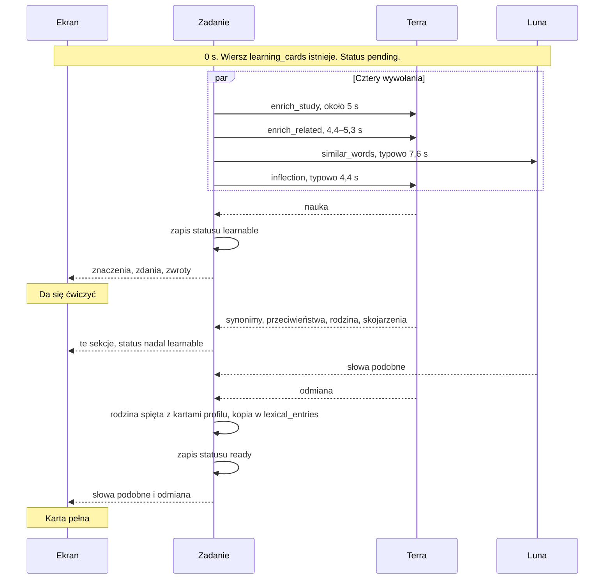

# Wzbogacanie jednej karty

Przebieg po zapisie wiersza w `learning_cards`. Opis decyzji jest w `docs/optymalizacja-requestow.md`, punkt 6. Czasy są typowe.

Nauka i powiązane: pomiar 8 listopada 2026, `gpt-5.6-terra`, bez myślenia, para polski–hiszpański. Nauka przy dwóch znaczeniach 5,1–5,3 s, w weryfikacji na pięciu hasłach 2,9–5,7 s. Powiązane 4,4–5,3 s, w weryfikacji w formacie REL2 3,2–5,7 s. Słowa podobne i odmiana: produkcja z 90 dni, bez zmiany polecenia. Słowa podobne typowo 7,6 s (90. percentyl 12,3 s). Odmiana typowo 4,4 s (90. percentyl 19,8 s). Czas spięcia rodziny z kartami profilu i kopii do `lexical_entries` nie był mierzony osobno.

Wykresy pokazują same wywołania modeli. Zakładają, że API stoi przy bazie, a zapisy metryk idą w tle (`docs/taski/01-region-api-i-bazy.md`, `docs/taski/02-zapisy-pomocnicze-w-tle.md`). Dziś typowa karta od wiersza do `ready` to 43 s przy oknie modeli 24,7 s. Reszta to podróże do bazy po około 141 ms (`docs/optymalizacja-requestow.md`, rozdział 0).

## Oś czasu

Cztery wywołania startują razem, w chwili gdy wiersz karty już jest.

```mermaid
gantt
    title Przebieg jednej karty, czasy typowe
    dateFormat x
    axisFormat %s
    section Ekran
    Hasło, wybrane tłumaczenie, nazwa listy     :screen_shell, 0, 5000
    Znaczenia, zdania, zwroty, ćwiczenie        :screen_learn, 5000, 3000
    Synonimy, rodzina, skojarzenia              :screen_rel, 5000, 3000
    Słowa podobne i odmiana                     :screen_ready, 8000, 1000
    section Modele
    Nauka, terra, około 5 s                     :study, 0, 5300
    Powiązane, terra, 4,4–5,3 s                 :related, 0, 5000
    Słowa podobne, luna, typowo 7,6 s           :similar, 0, 7600
    Odmiana, terra, typowo 4,4 s                :infl, 0, 4400
    section Status karty
    learnable, do ćwiczenia                     :milestone, learn, 5300, 0
    ready, karta pełna                          :milestone, ready, 8000, 0
```

Pasek `ready` stoi przy 8 s, bo przy typowych czasach ostatnie z czterech wywołań to słowa podobne, 7,6 s. Gdy odmiana jest w 90. percentylu, 19,8 s, `ready` jest po niej.

## Co leci równolegle

Kolejność powrotów na wykresie jest typowa, nie obowiązkowa. Powiązane, które wrócą przed nauką, zadanie trzyma do zapisu `learnable` i dokleja w tym samym commicie. Ekran nie czeka z ćwiczeniem na powiązane, słowa podobne ani odmianę.

## Co jest na karcie

| Moment | Status | Czas od wiersza | Co użytkownik widzi | Co karta zawiera | Ćwiczenie | Pełna |
|---|---|---|---|---|---|---|
| Zapis wiersza | `pending` | 0 | Hasło, tłumaczenie wybrane z listy, nazwa listy. Sekcje bez treści mają kółko | Lema, część mowy, jedno tłumaczenie | Nie | Nie |
| Koniec nauki | `learnable` | około 5 s | Znaczenia, zdania A2, B2 i C2, zwroty, notka przy haśle. Kółko schodzi z sekcji, które już doszły. Zostaje przy pustych | Jedno albo dwa znaczenia, po 3 zdania, co najmniej 2 zwroty na znaczenie, IPA, `headword_note`, znacznik `related_pending` | Tak | Nie |
| Koniec dopisania | `ready` | po nauce; typowo koło 8 s, przy wolnej odmianie do około 20 s | Kółek przy pustych sekcjach nie ma. Pusta sekcja zostaje pusta | Nauka, synonimy, przeciwieństwa, rodzina, 16–18 skojarzeń, słowa podobne (co najmniej 7, model proszony o 12), wymagana odmiana, kopia w `lexical_entries` | Tak | Tak |

Ćwiczenie to fiszka i wpisywanie na znaczeniach ze zdaniami. Pełna karta to `content_is_complete` (`backend/app/services/card_jobs.py`): zdania, wymagana odmiana (`_has_required_inflection`), co najmniej 7 słów podobnych (`MIN_SIMILAR_FOR_QUIZ`) i, po podziale rdzenia, brak znacznika `related_pending`. 12 (`MIN_SIMILAR_WORDS`) to liczba, o którą `finish_side_jobs` prosi model.

Odmiana, która „nie dotyczy” hasła (zwrot bez czasownika, na przykład `de repente`), jest zapisana jako wynik końcowy i nie blokuje `ready` (`docs/taski/03-petla-learnable.md`). Dziś takie karty zostają `learnable` na zawsze.

## Ekran, niezależnie od widoku

Ustalone 11 listopada 2026. Karta jest widoczna od razu po zapisie wiersza. Uczyć się da się, gdy są znaczenia, zdania i zwroty. Reszta dochodzi w swoich sekcjach. Żadna czynność użytkownika nie zatrzymuje dociągania.

1. Po dodaniu karta jest zapisana. Na liście i w wyniku szukania widać hasło, wybrane tłumaczenie i nazwę listy. Nie czeka się z pokazaniem karty na przykłady, odmianę ani powiązane.
2. Ćwiczenie (fiszka, wpisywanie) włącza się, gdy doszła nauka. Nie czeka na synonimy, rodzinę, skojarzenia, słowa podobne ani odmianę.
3. Oglądanie karty w nauce, otwarcie jej z listy, zamknięcie karty, przerwanie nauki, wyjście z aplikacji i każde inne przejście między ekranami nie anuluje zadania na serwerze. Serwer dociąga dalej.
4. Otwarta karta pokazuje treść sekcji natychmiast, jeśli ta treść już jest w karcie. Nie ma osobnego odświeżenia.
5. Sekcja bez treści pokazuje kółko tylko wtedy, gdy dociąganie tej sekcji jeszcze trwa. Gdy zadanie się skończyło, a sekcja została pusta, kółka nie ma.
6. Gdy karta jest otwarta i w sekcji widać kółko, treść zastępuje kółko w chwili zapisu tej sekcji. Dotyczy listy, podglądu karty i nauki. Użytkownik nie zamyka karty, żeby zobaczyć nową treść.

Instrukcja telefonu: `docs/taski/10-nauka-i-powiazane.md`, sekcja „Zachowanie telefonu”. Odpytywanie: `EnrichmentPoller` (scope procesu). Kółka per sekcja: `CardSectionWaiting`. Otwarta karta: `observeCard` z Room.

## Skąd który fragment

| Fragment | Wywołanie | Model | Kiedy wchodzi na kartę |
|---|---|---|---|
| Znaczenia, zdania, zwroty, IPA, `headword_note` | `enrich_study` | `gpt-5.6-terra`, bez myślenia | `learnable` |
| Synonimy, przeciwieństwa, rodzina, skojarzenia | `enrich_related` | `gpt-5.6-terra`, bez myślenia | gdy to wywołanie wróci; status zostaje `learnable`, dopóki brakuje słów podobnych albo odmiany |
| Brakujące rodzajniki w powiązanych | `article_repair` (`fill_related_articles_on_core`) | `gpt-5.6-luna` | razem z powiązanymi, tylko gdy rzeczownikowi brakuje pola `article` |
| `ui_hints` (pismo, kierunek, rodzaj odmiany, pokazanie koniugacji) | kod, manifest języka | brak | `learnable` |
| Słowa podobne | `similar_words` | `gpt-5.6-luna` | `ready` |
| Odmiana | `inflection` | `gpt-5.6-terra` | `ready` |
| Kopia dla następnego użytkownika tej samej pary | zapis do `lexical_entries` | brak | `ready` |
| Rodzina spięta z kartami profilu | odczyt kart profilu i `word_families` | brak | po powiązanych, przed `ready` |

Telefon odświeża kartę przez `GET /api/v1/cards/{id}` co 2,5 s, aż status wyjdzie z `pending`, `preparing` i `learnable`. Karta `learnable` wypada z odpytywania, gdy `GET /cards/{id}` odda `enrichment_active=false`, a najpóźniej po 3 minutach od pierwszego odpytania (`docs/taski/03-petla-learnable.md`). Dziś `HomeViewModel` odpytuje ją bez końca.

## Gdy coś nie dojdzie

| Co padło | Status karty | Co widzi użytkownik | Co dalej |
|---|---|---|---|
| Nauka | `preparing` z `enrichment_retry_at` | Hasło, tłumaczenie, kółko przy znaczeniach | Dotychczasowe ponowienie (`_apply_enrich_retry`) |
| Powiązane | `learnable` z `related_pending` | Fiszka działa, kółka przy synonimach, rodzinie, skojarzeniach | Ponowienie tylko `enrich_related`; karta nie trafia do `lexical_entries` |
| Słowa podobne albo odmiana | `learnable` | Fiszka działa, kółka przy tych sekcjach, dopóki telefon odpytuje kartę | Ponowienie co 15 minut, najwyżej 3 razy (task 03). Potem karta zostaje `learnable` bez dalszych prób |
| Odmiana „nie dotyczy” | `ready` | Sekcja odmiany pusta, bez kółka | Nic, wynik końcowy |

## Rejestr zmian

### 8 listopada 2026: weryfikacja

- Czasy nauki i powiązanych uzupełnione o weryfikację (2,9–5,7 s i 3,2–5,7 s) i o zastrzeżenie, że wykres pomija podróże do bazy. Powód: pomiar gołego API i produkcja (43 s od wiersza do `ready` przy 24,7 s modeli).
- `dateFormat X` zamienione na `dateFormat x`. Powód: w Mermaid `X` to sekundy uniksowe, a wartości osi są w milisekundach. Przy `X` pasek nauki miałby 5300 s.
- Było: pełna karta wymaga 12 słów podobnych. Jest: co najmniej 7 (`MIN_SIMILAR_FOR_QUIZ`), 12 to cel prośby do modelu. Powód: kod `content_is_complete` i `finish_side_jobs`.
- Dodany znacznik `related_pending` w bramce `ready` i w tabeli. Powód: po podziale rdzenia `content_is_complete` nie sprawdza powiązanych i zapisałoby niepełną kartę do `lexical_entries`.
- Dodane `headword_note` w nauce. Powód: telefon pokazuje to pole pod hasłem, a polecenie nauki z pomiaru go nie miało.
- Dodane wiersze `article_repair` i `ui_hints`. Powód: kod `run_lemma_enrichment` i `assemble_core_card`. Dokument ich nie przypisywał do żadnej części.
- Dodana sekcja „Gdy coś nie dojdzie” i zdanie o odmianie „nie dotyczy”. Powód: siedem kart-zwrotów na produkcji zostaje `learnable` na zawsze i jest odpytywanych bez końca.
- Limit odpytywania opiera się na fladze `enrichment_active` z `GET /cards/{id}` i na 3 minutach, nie na `updated_at`. Powód: `CardResponse` nie ma pola `updated_at`. Limit ponowień to 3. Powód: decyzja w tasku 03.
